<!-- Written by scripts/build.mjs. Change the words in scripts/content.mjs, then run it. -->
<p><a name="top"></a><a href="#top"><picture><source media="(max-width: 600px)" srcset="assets/tab-meshack-on-narrow.svg"></picture></a><a href="#work"><picture><source media="(max-width: 600px)" srcset="assets/tab-work-narrow.svg">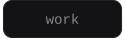</picture></a><a href="#clients"><picture><source media="(max-width: 600px)" srcset="assets/tab-clients-narrow.svg">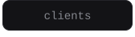</picture></a><a href="#npm"><picture><source media="(max-width: 600px)" srcset="assets/tab-npm-narrow.svg">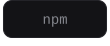</picture></a><a href="#stack"><picture><source media="(max-width: 600px)" srcset="assets/tab-stack-narrow.svg">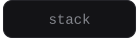</picture></a><a href="#contact"><picture><source media="(max-width: 600px)" srcset="assets/tab-contact-narrow.svg">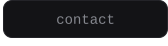</picture></a><br><a href="#work"><picture><source media="(max-width: 600px)" srcset="assets/terminal-narrow.svg"></picture></a></p>

<p><a name="work"></a><a href="#top"><picture><source media="(max-width: 600px)" srcset="assets/tab-meshack-narrow.svg">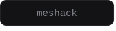</picture></a><a href="#work"><picture><source media="(max-width: 600px)" srcset="assets/tab-work-on-narrow.svg"></picture></a><a href="#clients"><picture><source media="(max-width: 600px)" srcset="assets/tab-clients-narrow.svg"></picture></a><a href="#npm"><picture><source media="(max-width: 600px)" srcset="assets/tab-npm-narrow.svg"></picture></a><a href="#stack"><picture><source media="(max-width: 600px)" srcset="assets/tab-stack-narrow.svg"></picture></a><a href="#contact"><picture><source media="(max-width: 600px)" srcset="assets/tab-contact-narrow.svg"></picture></a><br><a href="#work"><picture><source media="(max-width: 600px)" srcset="assets/work-narrow.svg"></picture></a></p>

<details>
<summary><code>$ ls ~/work | tail -11</code></summary>
<br>

<p><a href="#work"><picture><source media="(max-width: 600px)" srcset="assets/work-more-narrow.svg"></picture></a></p>

</details>

<p><a name="clients"></a><a href="#top"><picture><source media="(max-width: 600px)" srcset="assets/tab-meshack-narrow.svg"></picture></a><a href="#work"><picture><source media="(max-width: 600px)" srcset="assets/tab-work-narrow.svg"></picture></a><a href="#clients"><picture><source media="(max-width: 600px)" srcset="assets/tab-clients-on-narrow.svg"></picture></a><a href="#npm"><picture><source media="(max-width: 600px)" srcset="assets/tab-npm-narrow.svg"></picture></a><a href="#stack"><picture><source media="(max-width: 600px)" srcset="assets/tab-stack-narrow.svg"></picture></a><a href="#contact"><picture><source media="(max-width: 600px)" srcset="assets/tab-contact-narrow.svg"></picture></a><br><a href="#clients"><picture><source media="(max-width: 600px)" srcset="assets/clients-narrow.svg"></picture></a></p>

<p><a name="npm"></a><a href="#top"><picture><source media="(max-width: 600px)" srcset="assets/tab-meshack-narrow.svg"></picture></a><a href="#work"><picture><source media="(max-width: 600px)" srcset="assets/tab-work-narrow.svg"></picture></a><a href="#clients"><picture><source media="(max-width: 600px)" srcset="assets/tab-clients-narrow.svg"></picture></a><a href="#npm"><picture><source media="(max-width: 600px)" srcset="assets/tab-npm-on-narrow.svg">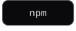</picture></a><a href="#stack"><picture><source media="(max-width: 600px)" srcset="assets/tab-stack-narrow.svg"></picture></a><a href="#contact"><picture><source media="(max-width: 600px)" srcset="assets/tab-contact-narrow.svg"></picture></a><br><a href="#npm"><picture><source media="(max-width: 600px)" srcset="assets/npm-narrow.svg"></picture></a></p>

<details>
<summary><code>$ history | grep npx</code></summary>
<br>

**[`callbackdesk`](https://www.npmjs.com/package/callbackdesk)** `0.1.0`

```sh
npx callbackdesk doctor <your-callback-url>
```

**[`daraja-skills`](https://www.npmjs.com/package/daraja-skills)** `0.2.0`

```sh
npx daraja-skills install
```

**[`@meshark/safaricom-daraja-mcp`](https://www.npmjs.com/package/@meshark/safaricom-daraja-mcp)** `1.0.1` · [source](https://github.com/Meshhack/safaricom-daraja-mcp)

```sh
npm i -g @meshark/safaricom-daraja-mcp
```

**[`@meshark/create-mini-app`](https://www.npmjs.com/package/@meshark/create-mini-app)** `1.0.3`

```sh
npx @meshark/create-mini-app my-store --template e-commerce
```

**[`create-safaricom-mini-app`](https://www.npmjs.com/package/create-safaricom-mini-app)** `1.0.0`

```sh
npx create-safaricom-mini-app my-app
```

</details>

<p><a name="stack"></a><a href="#top"><picture><source media="(max-width: 600px)" srcset="assets/tab-meshack-narrow.svg"></picture></a><a href="#work"><picture><source media="(max-width: 600px)" srcset="assets/tab-work-narrow.svg"></picture></a><a href="#clients"><picture><source media="(max-width: 600px)" srcset="assets/tab-clients-narrow.svg"></picture></a><a href="#npm"><picture><source media="(max-width: 600px)" srcset="assets/tab-npm-narrow.svg"></picture></a><a href="#stack"><picture><source media="(max-width: 600px)" srcset="assets/tab-stack-on-narrow.svg"></picture></a><a href="#contact"><picture><source media="(max-width: 600px)" srcset="assets/tab-contact-narrow.svg"></picture></a><br><a href="#stack"><picture><source media="(max-width: 600px)" srcset="assets/stack-narrow.svg"></picture></a></p>

<p><a name="contact"></a><a href="#top"><picture><source media="(max-width: 600px)" srcset="assets/tab-meshack-narrow.svg"></picture></a><a href="#work"><picture><source media="(max-width: 600px)" srcset="assets/tab-work-narrow.svg"></picture></a><a href="#clients"><picture><source media="(max-width: 600px)" srcset="assets/tab-clients-narrow.svg"></picture></a><a href="#npm"><picture><source media="(max-width: 600px)" srcset="assets/tab-npm-narrow.svg"></picture></a><a href="#stack"><picture><source media="(max-width: 600px)" srcset="assets/tab-stack-narrow.svg"></picture></a><a href="#contact"><picture><source media="(max-width: 600px)" srcset="assets/tab-contact-on-narrow.svg"></picture></a><br><a href="#contact"><picture><source media="(max-width: 600px)" srcset="assets/contact-narrow.svg">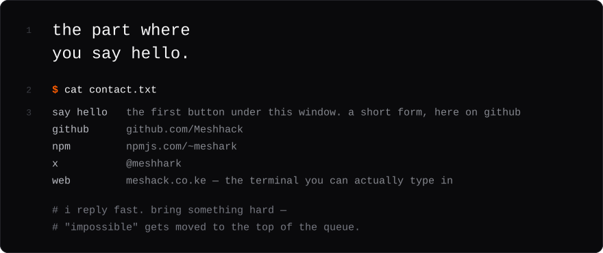</picture></a></p>

<p><a href="https://github.com/Meshhack/Meshhack/issues/new?template=hello.yml"><picture><source media="(max-width: 600px)" srcset="assets/btn-hello-narrow.svg"></picture></a><a href="https://github.com/Meshhack"><picture><source media="(max-width: 600px)" srcset="assets/btn-follow-narrow.svg">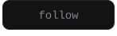</picture></a><a href="https://www.meshack.co.ke"><picture><source media="(max-width: 600px)" srcset="assets/btn-site-narrow.svg">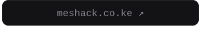</picture></a><a href="https://x.com/meshhark"><picture><source media="(max-width: 600px)" srcset="assets/btn-x-narrow.svg">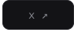</picture></a><br><a href="scripts/build.mjs"><picture><source media="(max-width: 600px)" srcset="assets/footer-narrow.svg">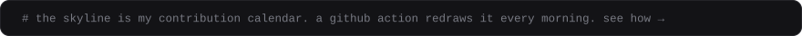</picture></a></p>
